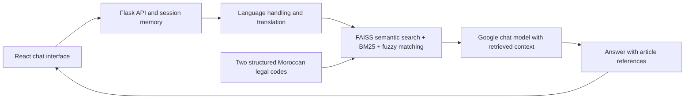

# Qannouni · Moroccan legal assistant

A multilingual RAG application that retrieves from the **Moroccan Penal Code and Code of Criminal Procedure**, then generates answers with article references. The project connects corpus preparation, hybrid retrieval and a conversational React interface.

**Built by Marouane Daouki and Imane Alouani.** Academic project.

## What the project demonstrates

- Preparing legal PDFs through extraction/OCR, cleaning and structured CSV/JSON data.
- Combining semantic retrieval with BM25 keywords, a Darija synonym map and fuzzy matching.
- Integrating Google-hosted embeddings and chat models with FAISS, Flask and React.
- Returning article references and prompting the model to decline questions outside the corpus.

The published repository contains the structured corpus and application. The earlier OCR and page-layout extraction experiments are project background, rather than a complete reproducible extraction pipeline in this repository.

## Architecture



See [the retrieval pipeline](backend/fullpipeline.py), [API routes](backend/app.py) and [React components](frontend/src/components).

## Run locally

Requirements: Python 3.10+, Node.js with npm, internet access and a Google API key authorized for compatible embedding and chat models.

```bash
git clone https://github.com/shirahex/moroccan-legal-chatbot.git
cd moroccan-legal-chatbot/backend
python -m venv .venv
# macOS/Linux
source .venv/bin/activate
# Windows PowerShell: .venv\Scripts\Activate.ps1
python -m pip install -r requirements.txt
```

Copy `.env.example` to `.env` in `backend/` and fill in your own key locally. Keep both corpus files in that directory. Start the API **from backend/** so relative data paths resolve:

```bash
python app.py
```

In another terminal, from the repository root:

```bash
cd frontend
npm ci
npm start
```

Frontend: http://localhost:3000 · API: http://localhost:5000

The first backend start builds an embedding index; later starts reuse it. Generation and indexing call external Google services and depend on account access, quotas and model availability. The original model identifiers are retained as defaults; override `GOOGLE_CHAT_MODEL`, `GOOGLE_TRANSLATE_MODEL` and `GOOGLE_EMBEDDING_MODEL` in `.env` when needed. Changing the embedding model requires a separate index, configured with `FAISS_INDEX_PATH_GOOGLE`.

Language detection uses `langdetect`; this code does **not** require a fastText `lid.176.bin` file.

## API

| Method | Route | Purpose |
| --- | --- | --- |
| POST | `/api/new-session` | Create a session identifier |
| POST | `/api/chat` | Ask a question with `message` and `session_id` |
| GET | `/api/history/<session_id>` | Read an active session |
| GET | `/api/sessions` | List sessions containing messages |

Sessions are held in process memory and reset when the API restarts.

## Evaluation and limits

Manual testing used challenging, mixed-language questions, article-reference checks and out-of-scope questions. Responses were observed at around **1–2 seconds in the author's test environment**. This is not a latency benchmark or a measured accuracy score; no labeled evaluation set is published here.

Citation and refusal behavior are model instructions, not guarantees. Translation, retrieval and generation can make mistakes. The corpus is limited to the included versions of the two codes and may not reflect later amendments. This is an educational prototype, not legal advice. The Flask debug server and in-memory sessions are intended for local development.

## Authors and reuse

Marouane Daouki · Imane Alouani. The existing project is described as academic/educational; no new software license is granted by this README.
